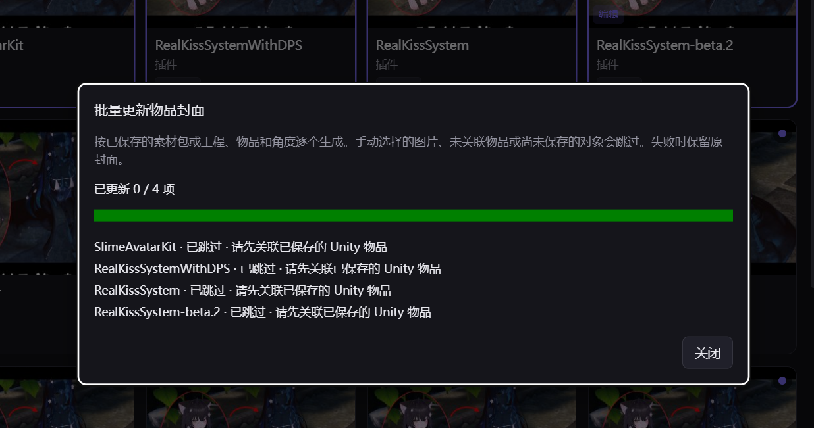

# Atrium 用户体验简化讨论稿

> 后续决定（2026-10-16）：用户已批准实施自动连接和导入目标自动选择，封面继续暂缓。实施范围以[已批准设计](../superpowers/specs/2026-10-16-unity-auto-connect-design.md)为准。下文保留讨论当日的状态和建议，不表示其他建议也已批准开发。
>
> **2026-10-21 再次改口（本条推翻 UX-13）**：用户明确要求移除所有常驻「导入到 Unity」按钮；双击素材卡 = 直接导入，双击合集卡 = 成员面板 + 全预勾，长按合集卡 1 秒 = 打开合集。讨论稿里「保留显眼的导入按钮 / 双击默认预览」的建议不再适用。10 条裁定见 [PROMPT-INTERACTION-SIMPLIFY.md](../PROMPT-INTERACTION-SIMPLIFY.md)。

- 日期：2026-10-15。
- 讨论基线：main `540b661`，包含 PR #9 的封面预览改进。
- 状态：讨论记录，不是已批准的开发规格，也不是功能完成报告。
- 本轮边界：只分析现状、讨论方案和保存文档；不修改产品代码，不执行桥接安装、素材导入或用户数据迁移，不提交、推送或创建 PR。
- 封面功能暂时维持现状；本文件只记录后续简化方向，不安排继续开发封面。

## 1. 这次要解决什么

普通用户的主要任务应当是：添加素材、找到素材、导入正在使用的 Unity 工程。用户不应先学习桥接、导入目标、资源关联、分类阈值和多个维护工具，才能完成这些任务。

目标是减少正常流程中的选择、重复确认和术语。重要操作应有明确结果，出问题时直接给下一步操作。已有的撤销、历史、备份和冲突处理继续发挥作用。

### 已收到的反馈与决定

| 项目 | 来源 | 当前结论 |
| --- | --- | --- |
| 更新封面要点很多按钮 | 好友反馈 | 认可需要简化；封面本轮暂不开发，仅记录方案。 |
| 不让用户自己找入口安装桥接 | 用户要求 | 讨论方向为打开 Unity 工程后自动准备连接，普通流程移除手动安装步骤。 |
| 自动选择导入目标 | 用户要求及本轮澄清 | **用户点击导入时，自动选择当前 Unity 工程。** 打开工程本身不会触发素材导入。 |
| 检查其他繁琐、低价值入口 | 用户要求 | 下文为建议，尚未批准实施；不能据此直接删除功能或更改默认设置。 |

### 如何判断是否变简单

以下是拟议的验收目标，当前尚未实施或测量：

1. 只打开一个受支持的 Unity 工程时，用户不需要安装桥接、勾选工程或设置导入目标。
2. 连接准备好后，无资源冲突的单包导入只需要一次“导入”操作。
3. 页面能说清“连接中”“等待 Unity 编译”“正在导入”“已完成”的区别，用户不用猜是否卡住。
4. 需要用户决定时，在任务发生的地方给出选择，不先把用户送到设置页。
5. 重要设置和排障能力仍可找到，但不占据普通操作的主要位置。

## 2. 证据与判断范围

本轮采用用户截图、好友反馈和当前代码流程分析。没有操控生产应用或重新走查全部界面，因此不能把以下全部建议称作已实测的界面缺陷。

- **S1：截图直接确认。** 下图为用户提供的好友界面：4 项全部跳过，进度条仍满格，提示需要先关联已保存的 Unity 物品。
- **F：代码确认的现状。** 文件中存在相关入口、设置、判断或操作步骤；这能证明流程存在，不能单独证明每位用户都会受困。
- **P：产品建议。** 用于讨论，效果和取舍需要后续通过实际任务走查验证。

本环境没有可用的浏览器／桌面交互捕获通道，本轮不制作完整的截图流程审计。仅保存并使用已检查的用户原始截图；其他界面建议按 F/P 标记，不借用历史生成截图作为本轮实测证据。

### S1：批量封面全部跳过

这一步的状态表达需要改进：满格表示处理结束，用户容易理解成更新成功；“先关联”给出了条件，却没有直接提供完成条件的入口。只依赖颜色也不足以区分全部成功、部分完成和全部跳过。截图不能验证键盘操作、屏幕阅读器或完整对比度合规情况。

## 3. 封面：暂缓开发，先记下简化方向

### 当前事实

F：单项编辑有素材包／工程来源、依赖工程、候选、角度、背景、生成和保存等控件。批量更新复用已保存的来源、对象及角度；没有可复用记录时跳过。普通商品图不等于已经保存了可重拍的物品关联。

现有默认素材包预览已会自动查找候选并生成图片，并非每次都必须手动点“生成”。真正的负担是把来源、依赖、首次设置、重新拍摄等不同状态一并交给用户理解。

### 推荐的后续方向（P）

- 已关联物品：卡片上的“刷新封面”直接按上次配置重拍，完成后给出“撤销”。角度和来源配置移到“调整封面”。
- 第一次设置：普通入口叫“生成封面”，自动选择可用来源及已知依赖，直接展示候选。用户选图后“用作封面”，复杂设置放入“更多选项”。
- 单候选是否可以直接采用、已有商品图是否允许自动覆盖，是独立的产品决定，本轮没有批准默认自动覆盖。
- 批量任务先说明有多少项可刷新、多少项需要首次设置。缺少关联的项目提供“选择物品”，不只显示跳过原因。
- 结果明确区分“已处理 4 项：更新 0，需设置 4”，全部跳过不用成功样式表达。
- 没有可渲染模型的功能插件提供“使用本地图片”等合适入口，不引导用户反复尝试拍摄空对象。

首次设置和已有关联的更新可以共用入口，由系统识别状态，但不能共用一句模糊的结果说明。插件封面也不必强制走 Unity 拍摄。

## 4. 桥接：让“连接 Unity”成为自动准备过程

### 当前事实（F）

工程发现、桥接安装和在线状态检查已有基础能力。当前同时存在首次向导里的安装步骤、发现工程后的连接弹窗、逐工程自动安装意愿、全局自动安装开关，以及工程页安装／卸载按钮。`bridgeAutoInstall` 默认关闭。

现有自动安装在“首次发现”或运行边沿参与判断，因此**不能只把开关默认改成开启**：首次发现的关闭工程也可能进入原有安装路径，这与“打开哪个工程就准备哪个”不同。

### 推荐正常路径（P）

1. Atrium 识别一个实际打开、位于支持范围内的用户 Unity 工程。
2. 缺少连接插件时自动安装；已兼容时复用，确实需要更新时安排兼容更新。
3. 显示“正在连接工程 X”，等待 Unity 完成编译和握手。
4. 真正收到可用状态后显示“已连接：X”。不把“文件复制成功”当作“已经能导入”。
5. 用户在准备期间点导入，保留这次请求并显示当前等待原因，准备完成后继续。

正常流程取消“是否安装”“只这次／以后自动”“先去工程页连接”等选择。自动准备只处理实际打开的用户工程，不批量改动磁盘上所有已发现工程；内部封面预览工程继续排除。

普通界面使用“连接 Unity”“正在准备连接”等语言。桥接版本、Packages 路径、安装日志和诊断依据放到“连接详情”。手动重连、排除某个工程、关闭自动连接及卸载保留为高级或故障恢复入口，不要求普通用户先配置。

### 两种准备时机

| 方案 | 好处 | 代价 | 本稿建议 |
| --- | --- | --- | --- |
| 打开工程后立即准备 | 用户点导入前通常已经就绪，符合本轮反馈 | 需要识别运行工程、处理编译和安装失败 | **首选**。 |
| 第一次点导入时再准备 | 只给实际使用的工程安装 | 第一次导入等待更长，需要让任务连续等待 | 可作为漏检或延迟发现时的补救，不取代首选流程。 |

### 需要表达清楚的异常

- Unity 编译或导入中：显示“等待 Unity 准备完成”，不用反复弹安装对话框。
- 文件已复制但 Unity 尚未刷新：持续等待；确实需要用户切回 Unity 时，只给这一步操作提示，不声称已连接。
- 工程不可写、当前版本不支持或插件加载失败：保留可识别原因，提供重试和查看详情；不每轮检测都刷屏。
- 原有连接代码可能经过手动修改：兼容升级策略需要另定，不能把“自动安装”直接等同于每次打开都强制覆盖。
- 工程关闭：撤销其“可用”状态；正在准备的请求说明去向，不静默转投其他工程。

本轮只讨论这些规则，不实际向任何 Unity 工程写入插件。

## 5. 导入目标：自动选择，但导入仍由用户触发

用户已确认：**点击导入时自动选当前工程，不是打开工程就导入素材。**

### 推荐选择规则（P，多个工程的细节仍待讨论）

| 情况 | 建议行为 |
| --- | --- |
| 只打开一个受支持的用户工程 | 自动使用它，按钮直接显示“导入到 X”。连接仍在准备时，保留任务并显示进度。 |
| 没有打开工程 | 在当前位置提示“请打开 Unity 工程”；检测到后更新按钮，不让用户先去找“导入目标”设置。 |
| 同时打开多个工程，能可靠确定用户当前使用者 | 可推荐最近使用的工程，入口显示明确工程名；可靠的激活识别需要补充验证。 |
| 同时打开多个工程，无法可靠确定当前使用者 | 在导入入口就地选择一次；不按项目列表第一项、文件夹名称或模型猜测来写入工程。 |
| 用户明确固定了某个工程 | 显示固定状态，在用户解除前沿用；固定工程关闭时提示处理。此项可放高级入口。 |
| 导入或一批排队任务已经开始 | 固定该任务的目标。后续切换／新开工程不改变已经提交的任务去向。 |

“识别到某工程开着”“当前浏览哪个模型集合”“实际写入哪个工程”是三个不同状态。现在的自动匹配集合不能直接当作自动导入目标；浏览集合可以失败或有歧义，资源写入仍必须指向确定的工程。

已经存在工程发现、目标设置、预检查和队列能力，后续重点是统一这三个状态的规则及界面反馈。仅凭当前代码不能承诺已具备可靠的前台 Unity 工程识别。

### 普通用户看到的路径

打开 Unity 工程 → Atrium 自动连接 → 找到素材 → 点击“导入到 X” → 显示进度和结果。

选项、连接进度和错误处理在这条路径上完成，不把正常任务拆成“去设置、去当前工程、回来选素材、再确认”几段。

## 6. 其他值得简化的地方

优先级是讨论建议：P0 影响主任务，P1 高频减负，P2 低频入口整理。成本以相对工作量表示，不是交付承诺。

| 编号 | 现状与依据 | 建议 | 优先级／相对成本 |
| --- | --- | --- | --- |
| UX-01 | F：桥接入口和安装意愿分散在向导、弹窗、设置、工程页 | 正常路径统一为自动连接；高级页保留恢复能力 | P0／中 |
| UX-02 | F：点导入前要求已有 `targetProjectId`，顶栏和工程页可分别设置 | 单工程自动选目标，导入按钮显示名字，多工程按明确规则处理 | P0／中；可靠前台识别另算 |
| UX-03 | F：在线模型开关、Endpoint、Model 仅出现在设置和类型／默认值中，当前没有实际分类调用链 | 从正式设置收起未接入功能；真正接入时再提供入口 | P1／小 |
| UX-04 | F：首次向导有素材库、来源目录、桥接、开机偏好四步，后三步可跳过 | 首次只处理必需的素材库；来源目录提供稍后添加，Unity 自动连接，启动偏好放设置 | P1／中 |
| UX-05 | F：无冲突单包也可能因默认确认设置而弹框；批量又有独立确认流程 | 无冲突直接执行并可撤回；有覆盖时集中展示真实影响，一批只作一次有效决定 | P1／中 |
| UX-06 | F：合集导入存在成员挑选、准备、分批确认及“下一批”操作 | 只让用户选择确有歧义的成员；纯内部批次自动连续执行，持续显示总进度 | P1／中到大 |
| UX-07 | F：集合规则包含关键词、匹配方式、优先级、工程路径；侧栏有“按库里出现过的模型补建” | 普通入口按“模型”浏览；关键词／优先级放高级规则。“管理模型”承载补建，不占主操作位置 | P1／中 |
| UX-08 | F：收件箱同时有“选择文件”和文字不明确的“＋选择”，并展示较多处理阶段 | 主按钮统一叫“添加素材”，文件／文件夹放清楚的菜单；保留拖入，给用户明确的下一步 | P1／小 |
| UX-09 | F：置信度、内部来源类型、指纹／锁文件／WMI 诊断等内容常驻不同界面 | 正常展示名称、封面、适用模型、分类和主要操作；技术依据折叠进详情，仅待确认时突出不确定性 | P1／小到中 |
| UX-10 | F：入库、导入、合并提醒、项目切换等各有状态条或弹窗 | 成功用简短结果和撤销；仅需要决定的内容占用模态框，减少同时堆叠的状态条。优先整理已有反馈，不先新建复杂任务系统 | P1／中 |
| UX-11 | F：侧栏同时列出“合集”和“集合”，所有分类按配置展开 | 用“素材包合集”和“模型／自定义分组”等名称区分；低频／空分类折叠，仍可展开查看全部 | P2／小到中 |
| UX-12 | F：维护页分别提供索引重建、归并、拆组、再合并、重新分析、库检查 | 以“搜索不准”“同商品重复”“分类有误”等问题组织入口，执行前显示影响；具体工具保留在高级维护 | P2／中 |
| UX-13 | F：双击行为可配置为导入、预览或打开文件位置，用户可能不了解双击会产生工程写入 | ~~讨论是否默认双击查看详情／预览，保留显眼的导入按钮和快捷键~~ **2026-10-21 用户否决：按钮全删、双击固定为导入、长按 1 秒打开合集** | P2／小 → 已按新裁定实施（0.8.0） |
| UX-14 | F：存储模式、目录模板、解压位置、自动解压、自动归档等设置并列 | 一开始以“保留原位置”或“由 Atrium 整理到素材库”解释结果；沿用已选策略，目录模板和缓存细节放高级设置 | P1／中 |

### 真正低价值与应该保留的能力

最适合直接从正式流程收起的是尚未接入的在线模型设置、技术诊断字段和重复安装入口。其他多数能力有用途，问题是出现的时机与表达，而非功能本身没有价值。

应保留：搜索及别名、分类纠正、密码输入、版本／适配款选择、资源冲突信息、撤销、导入历史、文件备份和失败重试。

这些能力只在相关任务中出现。例如无冲突不要求用户判断覆盖；发生覆盖时说清会替换什么。不同模型的适配包不能只为了省一次点击而全部自动导入。

文件处理也不应和界面简化混为一谈。减少入库确认不等于默认移动已有目录、删除原包或全量解压；先沿用用户已有存储设置，空库默认行为另作产品决定。

## 7. 名称和反馈的讨论示例

以下均是建议文案，不代表已经替换：

| 当前表达／情境 | 建议表达／操作 |
| --- | --- |
| 桥接未安装，先去工程页安装 | 正在连接 Unity 工程 X… |
| 导入目标：未选择（只有一个工程已打开） | 导入到 X |
| 播放或编译时导入 | 已排队，等待 Unity 退出播放／完成编译 |
| 请先关联已保存的 Unity 物品 | 还没选择封面物品 · 选择物品 |
| 已更新 0/4，但进度满格 | 已处理 4 项：更新 0，需设置 4 |
| 置信度 32% | 分类待确认 · 修改分类；判断依据可展开 |
| 合集／集合 | 素材包合集／模型与自定义分组（具体名称待讨论） |
| WMI、lockfile、bridge | 已连接／连接中／未连接；诊断依据放详情 |

## 8. 建议先后顺序

1. **先讨论并确定自动连接和自动目标规则。** 尤其是多个工程、准备中点导入、工程关闭以及失败恢复。它们决定后续界面能省掉哪些步骤。
2. **优先打通一次普通导入。** 按“打开工程、选素材、点导入”的完整任务验证，不以减少几个按钮作为完成标准。
3. **收起未生效选项和技术信息，缩短首次配置。** 保留老用户已有选择，避免升级后突然改变文件处理方式。
4. **再整理合集导入、模型分组和维护入口。** 这些流程需要分别走查，不能只凭组件数量决定删除。
5. **封面等用户决定重启后再优化。** 当前只保留这份问题和方案记录。

本稿没有排定开发日期或要求立即执行。自动连接涉及 Unity 刷新与状态确认，多工程目标涉及身份判定，合集简化涉及原有批次与撤回语义；这些通常比改按钮文案复杂。

## 9. 后续验证应覆盖的实际任务

此处是未来验收清单，本轮没有执行：

- 全新用户只开一个 Unity 工程，完成第一份素材导入。
- Atrium 启动前工程已经打开；Atrium 启动后再打开工程。
- 第一次连接需 Unity 编译；用户在准备完成前点导入。
- 两个工程同开、同名目录、工程中途关闭及导入期间切换工程。
- 无冲突、有覆盖、适配版本不确定、多包分批导入和取消。
- 已有“从不连接”／手动选择目标等旧偏好的升级处理，避免一部分界面仍沿用旧规则。
- 低磁盘空间、加密包、用户选择原位索引、重新分类涉及文件移动。
- 新手只依靠界面完成任务，记录点击次数、停顿位置、错误理解及恢复次数。
- 用键盘完成主任务；小窗口和系统缩放下主操作及结果可见。不能只按颜色区分成功、跳过和错误。

## 10. 代码依据索引

以下为本轮只读核对位置，用于以后继续讨论；注释中的历史说明不自动视为当前行为，以实际入口和调用链为准。

- [封面单项流程](../../src/renderer/components/CoverEditor.tsx)、[批量界面](../../src/renderer/components/CoverBatch.tsx)、[批量跳过规则](../../src/main/covers/service.ts)。
- [工程发现与打开边沿](../../src/main/project/api.ts)、[安装意愿判断](../../src/shared/bridgeAsk.ts)、[安装器](../../src/main/bridge/installer.ts)。
- [连接弹窗](../../src/renderer/components/BridgeAskDialog.tsx)、[工程页](../../src/renderer/pages/Project.tsx)、[顶栏及侧栏](../../src/renderer/components/chrome.tsx)。
- [自动匹配集合](../../src/main/project/autoSwitch.ts)、[导入入口及目标守卫](../../src/renderer/stores/ui.ts)。
- [首次向导](../../src/renderer/components/FirstRunWizard.tsx)、[设置](../../src/renderer/pages/Settings.tsx)、[默认设置](../../src/shared/settingsDefaults.ts)。
- [收件箱](../../src/renderer/pages/Inbox.tsx)、[详情面板](../../src/renderer/components/DetailPanel.tsx)、[分组规则](../../src/renderer/pages/Collections.tsx)。
- [导入确认与结果](../../src/renderer/components/ImportFlow.tsx)、[批量导入](../../src/renderer/components/BatchImportDialog.tsx)、[成员选择](../../src/renderer/components/MemberPicker.tsx)。

## 11. 待继续决定

1. 多工程时采用什么样的“当前工程”判定；无法确定时允许怎样的一次选择。
2. 自动连接失败时的默认重试、旧桥接兼容升级，以及用户主动排除工程的方式。
3. 无冲突导入是否默认免确认；升级时如何保留老用户原有偏好。
4. 模型入口和自定义分组的名称，以及哪些技术选项移入高级页。
5. 封面何时恢复优化；首次设置是否允许自动采用单一候选，需要单独确认。

以上是讨论问题，不是待执行任务。继续开发前应把选定范围、默认行为和异常路径整理成可审阅的规格，再按既有分支与 PR 约定开发。
